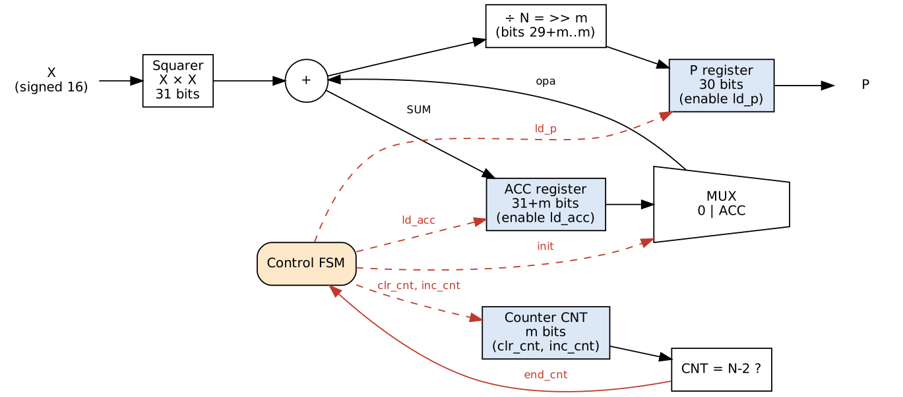
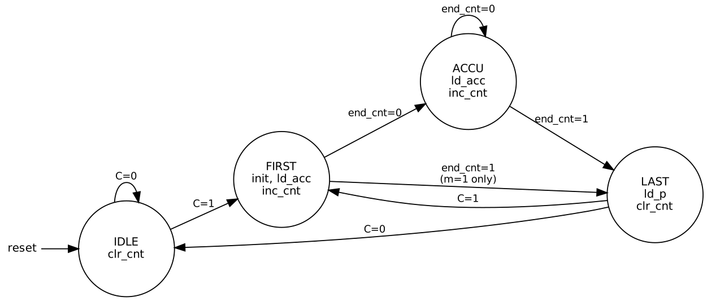
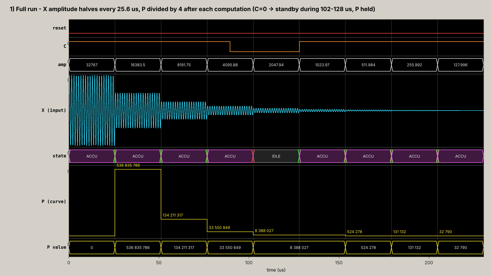
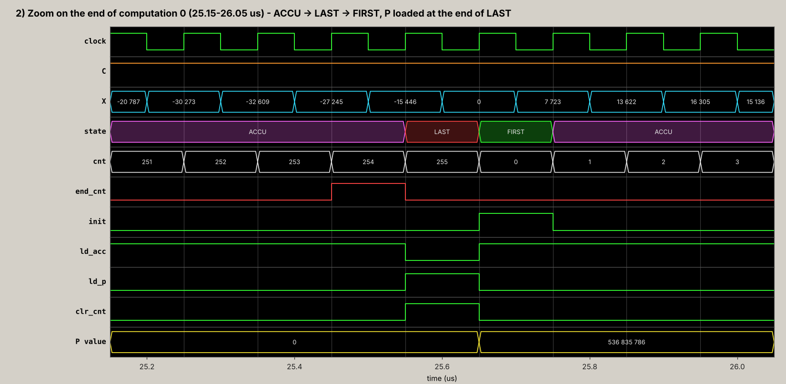
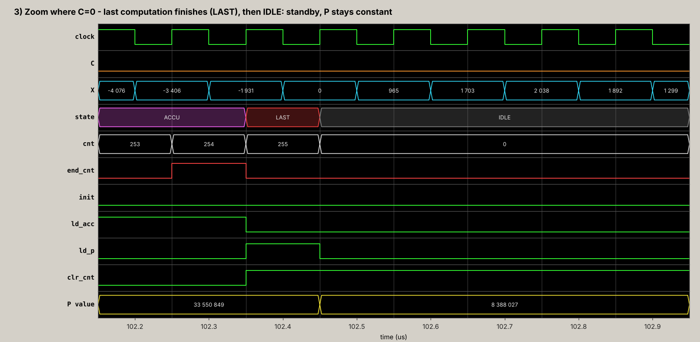

# Average Power Operator in VHDL: Data Path + Finite State Machine

A synthesizable VHDL operator that computes the **average power** of a sampled signal:

$$P = \frac{1}{N}\sum_{k=0}^{N-1} x_k^2 \qquad N = 2^m$$

The design is split into a **data path** (squarer, accumulator, counter, output register) and a **Moore state machine** that controls it. It comes with self-checking testbenches, ModelSim scripts, a free GHDL flow and a bit-exact Python reference model.

> Practical Sessions 5 & 6, *Advanced Digital Electronics*, M2 Integrated Circuits and Systems, Université Paris-Saclay (2026–2027).

---

## Specification

| Item | Value |
|---|---|
| Input `X` | `signed(15 downto 0)`, one sample per clock |
| Output `P` | `unsigned(29 downto 0)`, held until the end of the next computation |
| Control `C` | `1` → compute continuously; `0` → finish the current computation, then standby |
| `reset` | asynchronous, **active high** |
| Generic `m` | `N = 2**m` samples per computation (default `m = 10`, `N = 1024`) |

---

## Architecture

### Data path



| Block | Width | Role |
|---|---|---|
| Squarer `X × X` | 31 bits | `x² ≤ 2³⁰`, always ≥ 0 |
| Mux `0 / ACC` + adder | 31+m bits | `SUM = (init ? 0 : ACC) + x²` |
| Accumulator `ACC` | 31+m bits | holds the running sum |
| Counter `CNT` | m bits | sample index, status `end_cnt = (CNT = N−2)` |
| Output register `P` | 30 bits | `P = SUM(29+m downto m)`, i.e. division by `2^m` is a free right shift |

All operand sizes are derived from the generic `m`. Arithmetic uses `ieee.numeric_std` (`signed` / `unsigned`), because the accumulator (40 bits for `m = 10`) does not fit in a 32-bit VHDL `integer`.

### Control signals

| Signal | Direction | Meaning |
|---|---|---|
| `clr_cnt` | FSM → DP | synchronous clear of `CNT` |
| `inc_cnt` | FSM → DP | increment `CNT` |
| `init` | FSM → DP | adder mux: `0 + x²` instead of `ACC + x²` (first sample) |
| `ld_acc` | FSM → DP | load `ACC` |
| `ld_p` | FSM → DP | load the output register |
| `end_cnt` | DP → FSM | next sample is the last one of the window |

### State machine (Moore)



| State | Outputs | Action |
|---|---|---|
| `IDLE` | `clr_cnt` | standby, waits for `C = 1` |
| `FIRST` | `init, ld_acc, inc_cnt` | `ACC ← x²` (first sample) |
| `ACCU` | `ld_acc, inc_cnt` | `ACC ← ACC + x²` |
| `LAST` | `ld_p, clr_cnt` | `P ← (ACC + x²) / N` (last sample) |

`C` is only tested in `IDLE` and `LAST`, so dropping `C` mid-computation lets the operator **finish** before going to standby. `LAST → FIRST` chains computations back-to-back with no lost sample (this is why the `init` mux exists instead of clearing `ACC`).

---

## Repository layout

```
.
├── rtl/
│   ├── power_compute_e.vhd          entity (given)
│   └── power_compute_a1.vhd         architecture: FSM + data path
├── tb/
│   ├── test_power_compute_e.vhd     testbench entity (given)
│   ├── test_power_compute_a1.vhd    lab testbench  : m = 10, 50 Hz sine, 9.5 s
│   └── test_power_compute_fast.vhd  fast testbench : m = 8, 10 MHz clock, 0.22 ms
├── sim/modelsim/
│   ├── sim.do                       compile + simulate + waves (ModelSim)
│   └── wave.do                      clean Wave-window layout + bookmarks
├── scripts/
│   ├── golden_model.py              bit-exact Python reference model
│   └── plot_waves.py                VCD → ModelSim-style PNG waveforms
├── docs/
│   ├── datapath.dot, fsm.dot        Graphviz sources of the diagrams
│   └── img/                         diagrams and waveform pictures
└── Makefile                         GHDL flow
```

---

## Testbenches

Both testbenches generate a sine at the **maximum amplitude (32767)** and **halve the amplitude every N samples**. The sine frequency is chosen so that each computation window contains an integer number of periods, so the exact expected result is `A²/2`.

`C` is dropped in the middle of computation 3 and raised again just before computation 5, to check standby and restart. A `check` process reports every new `P`, the ratio to the previous one, and raises an error if `P` deviates from `A²/2` by more than 1 %.

| | `a1` (lab) | `fast` |
|---|---|---|
| `m` / `N` | 10 / 1024 | 8 / 256 |
| clock | 1000 ms / 1024 ≈ 1.024 kHz | 10 MHz |
| sine | 50 Hz (50 periods / window) | 781.25 kHz (20 periods / window) |
| simulated time | 9.5 s | 0.22 ms |

The sine phase is computed from a sample counter rather than `now/(1 ns)`, which would overflow the 32-bit `integer` range after 2.147 s of simulated time.

---

## How to run

### ModelSim / Questa (Intel FPGA edition)

```tcl
cd <repo>/sim/modelsim
do sim.do          ;# fast testbench (default)
do sim.do a1       ;# lab testbench
```

The script compiles everything, opens the Wave window with grouped, coloured signals (sine and power shown as analog curves) and adds bookmarks (*Wave → Bookmarks*) for: end of a computation, standby, restart.

### GHDL (free)

```bash
make sim-fast      # fast testbench
make sim           # lab testbench
make golden        # Python reference values
make waves         # regenerate docs/img/wave_*.png (needs matplotlib)
```

---

## Results

Simulated results equal the Python reference model **bit for bit**, and each new result is ≈ ¼ of the previous one.

| Computation | Amplitude | `P` (fast, N = 256) | `P` (a1, N = 1024) | `A²/2` | Ratio |
|---|---|---|---|---|---|
| 0 | 32767 | 536 835 786 | 536 838 003 | 536 838 144 | – |
| 1 | 16383.5 | 134 211 317 | 134 209 607 | 134 209 536 | 4.000 |
| 2 | 8191.75 | 33 550 849 | 33 552 454 | 33 552 384 | 4.000 |
| 3 | 4095.88 | 8 388 027 | 8 388 169 | 8 388 096 | 4.000 |
| 4 | *standby (C = 0)* | – | – | – | – |
| 5 | 1023.97 | 524 278 | 524 281 | 524 256 | 16.0 (two steps) |
| 6 | 511.98 | 131 132 | 131 048 | 131 064 | 4.00 |
| 7 | 255.99 | 32 790 | 32 772 | 32 766 | 4.00 |

The small deviations from `A²/2` come from rounding the input samples to integers.

### Waveforms (fast testbench)

**Full run:** the amplitude halves each window, `P` steps down by ¼, and `P` is held during standby.



**End of a computation:** `ACCU → LAST → FIRST`, with `P` loaded at the end of `LAST` and no gap between computations.



**C = 0:** the current computation finishes, then `IDLE`, and `P` stays constant.



---

## Author

Mubinur Rashid Tahjib, M2 Integrated Circuits and Systems, Université Paris-Saclay.
