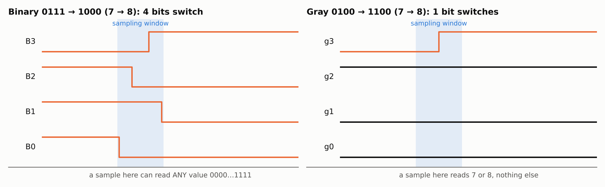
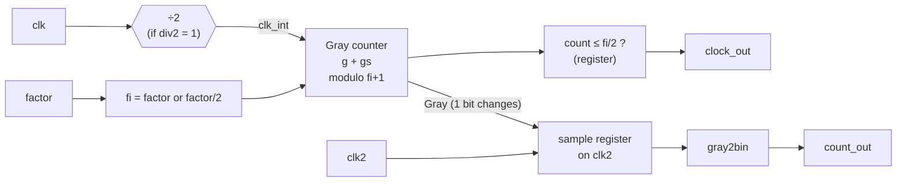
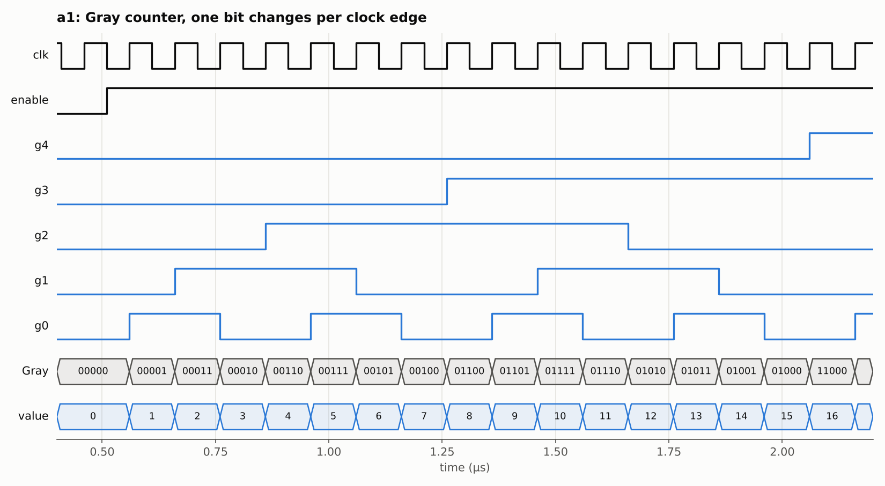
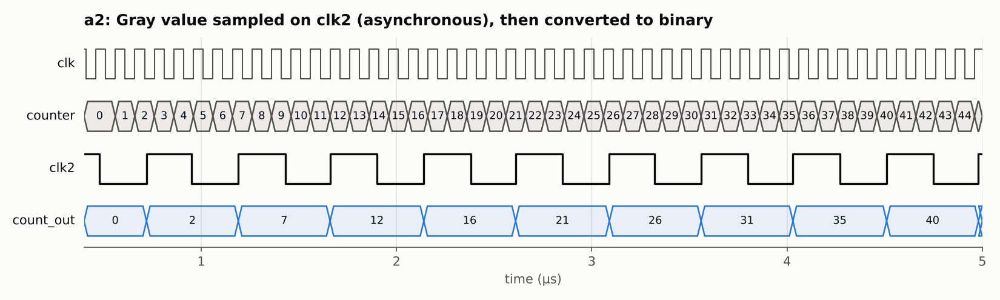
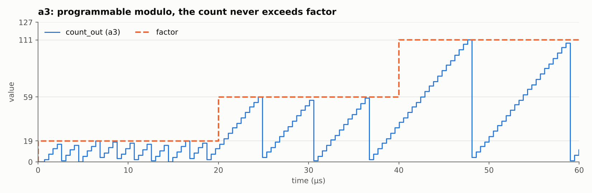
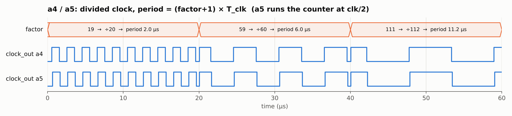

# Programmable Frequency Divider Based on a Gray Code Counter

VHDL design of a **7-bit Gray code counter** used as a **programmable clock divider**. The counter's output is sampled safely by a **second, asynchronous clock**.

> *Advanced Digital Electronics*, M2 Integrated Circuits and Systems, Université Paris-Saclay. Practical Sessions 7 & 8.
> Simulated in **ModelSim (Intel FPGA Edition)** and **GHDL**. All the plots below come from the real simulation data.

---

## 1. The problem: sampling a binary counter

When a binary counter goes from **7 (`0111`) to 8 (`1000`)**, all 4 bits switch. Each bit has a slightly different delay, so a clock that samples the counter during that moment can read **any value from 0 to 15**.

In **Gray code**, consecutive values differ by **exactly one bit**, so a sample always gives either the old value or the new value.



---

## 2. Counting rule with a virtual bit

A virtual bit `gs` is added to the right of the LSB. It is `1` when the count is even and toggles every cycle. Each Gray bit then toggles under a simple condition:

| Bit | Toggles when |
|---|---|
| `gs` | every clock cycle |
| `g0` | `gs = 1` |
| `gi` (1 ≤ i ≤ n−2) | `g(i−1) = 1` and `g(i−2..0) = 0` and `gs = 0` |
| MSB | `g(n−3..0) = 0` and `gs = 0` |

Hardware for the 3 LSBs (each bit is a toggle flip-flop, `D = Q xor T`):

```
gs : D = not gs
g0 : D = g0 xor gs
g1 : D = g1 xor (g0 · /gs)
g2 : D = g2 xor (g1 · /g0 · /gs)
```

---

## 3. Architecture



The design is built in five steps. Every architecture shares the same `gray_counter` entity.

| Architecture | Adds | Lab question |
|---|---|---|
| `a1` | Gray counter alone (active-low reset, `enable`) | Q6 |
| `a2` | Sampling of the Gray value on `clk2`, then `gray2bin` | Q7 |
| `a3` | Programmable modulo: counts `0 .. factor` | Q8 |
| `a4` | Generated clock `clock_out = f(clk) / (factor+1)` | Q9 |
| `a5` | Generic `div2`: counter runs at `clk/2`, internal factor halved | Q10 |

---

## 4. Results

### a1: Gray counter

Exactly **one bit changes at each clock edge**. The bottom row is the decoded value: 0, 1, 2, 3…



### a2: sampling with an asynchronous clock

The counter runs on `clk` (100 ns). `count_out` only updates on `clk2` (474 ns), advancing by **4 or 5** each time (474 / 100 = 4.74).

The Gray value is sampled **first** and converted **afterwards**. Converting before sampling would bring the multi-bit problem back, because `gray2bin` is an XOR chain.



### a3: programmable modulo

The count wraps at `factor` and follows it when it changes: 19, then 59, then 111. It never goes above `factor`.



### a4 / a5: divided clock

`clock_out` is `1` for the first half of each counting cycle. It is **registered**, so it has no glitches.

In **a5** the counter runs at **clk/2** with an internal factor `fi = factor/2`, and the output is **identical**. This lets the design accept an input clock twice as fast.



| factor | Division | Expected period | Measured a4 | Measured a5 |
|---|---|---|---|---|
| 19 | ÷20 | 2.0 µs | 2.0 µs ✔ | 2.0 µs ✔ |
| 59 | ÷60 | 6.0 µs | 6.0 µs ✔ | 6.0 µs ✔ |
| 111 | ÷112 | 11.2 µs | 11.2 µs ✔ | 11.2 µs ✔ |

*(Only the single transitional period right after each `factor` change differs.)*

**Limitation of a5:** the division is exact only when `factor+1` is even. An odd ratio cannot be split in two with this structure.

---

## 5. Files

| File | Description |
|---|---|
| `gray_counter_e.vhd` | Entity *(provided)* |
| `gray_counter_a1.vhd` … `gray_counter_a5.vhd` | The five architectures |
| `myfuncs_package.vhd`, `myfuncs_body.vhd` | `bin2gray` / `gray2bin` *(provided)* |
| `digital_gene_e.vhd`, `digital_gene_a1.vhd` | Stimuli: clk 10 MHz, clk2 474 ns, factor 19 → 59 → 111 *(provided)* |
| `test_gray_e.vhd`, `test_gray_a1.vhd` | Testbench *(provided)* |
| `tb_check.vhd` | Self-checking testbench, all architectures in parallel |
| `run.do` | ModelSim script |

## 6. How to run

**ModelSim**

```tcl
vlib tp78
vcom -2008 -work tp78 myfuncs_package.vhd
vcom -2008 -work tp78 myfuncs_body.vhd
vcom -2008 -work tp78 gray_counter_e.vhd
vcom -2008 -work tp78 gray_counter_a1.vhd
vcom -2008 -work tp78 digital_gene_e.vhd
vcom -2008 -work tp78 digital_gene_a1.vhd
vcom -2008 -work tp78 test_gray_e.vhd
vcom -2008 -work tp78 test_gray_a1.vhd
vsim -voptargs=+acc tp78.test_gray
add wave -r /*
run 60 us
```

To test another architecture, change `gray_counter(a1)` on line 44 of `test_gray_a1.vhd`.

**GHDL (automatic checks)**

```bash
ghdl -a --std=08 myfuncs_package.vhd myfuncs_body.vhd gray_counter_e.vhd \
  gray_counter_a1.vhd gray_counter_a2.vhd gray_counter_a3.vhd gray_counter_a4.vhd gray_counter_a5.vhd \
  digital_gene_e.vhd digital_gene_a1.vhd tb_check.vhd
ghdl -e --std=08 tb_check
ghdl -r --std=08 tb_check
```

---

**Mubinur Rashid Tahjib**, M2 ICS, Université Paris-Saclay · [LinkedIn](https://www.linkedin.com/in/mubinur-rashid-tahjib)
